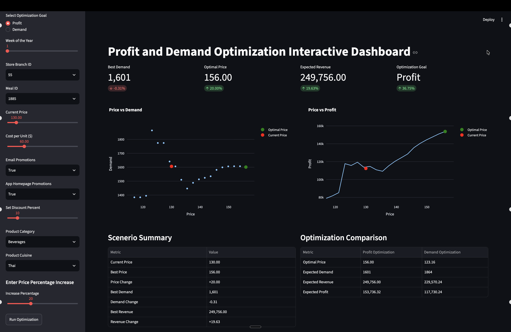
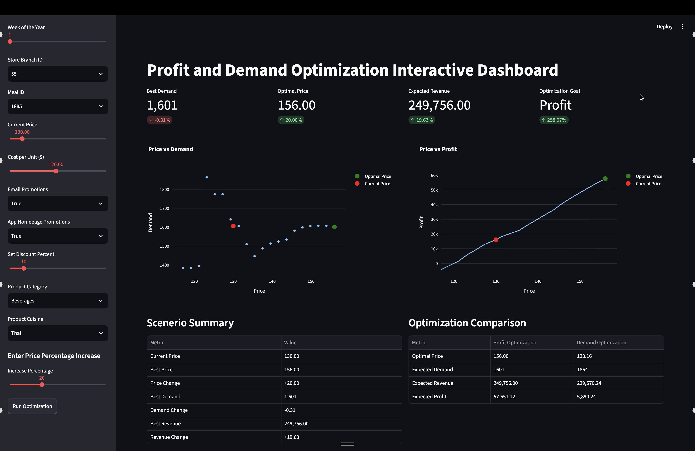

# AI Pricing Simulator
### A Machine Learning Replication & Extension | TKS Focus Project

Exploring how machine learning can predict customer demand and help businesses compare pricing decisions.

## Project Overview
This project investigates whether machine learning can help businesses identify profitable selling prices.
I replicated an existing pricing optimization application, examined how its demand prediction model works, and modified its functionality to experiment with different business assumptions.
The simulator predicts demand across 20 possible selling prices and compares estimated revenue and profit to recommend a price within the selected range.

## Original Project & Credits
Original repository: Price-Optimization by dlifeofjay (https://github.com/dlifeofjay/Price-Optimization)
The original creator developed the machine learning model, preprocessing pipeline, optimization logic, and initial application.
My work is an educational replication and extension of that project. I did not develop or train the original machine learning model.

## Technical Architecture
The application uses:

- Python: Core application and calculations
- Machine Learning: Predicts customer demand using a pretrained model
- NumPy: Generates 20 evenly spaced prices to evaluate
- Streamlit: Provides the interactive dashboard
- Preprocessing: Transforms inputs into the format expected by the model
- Optimization: Compares the predicted outcomes and selects the best option for the chosen objective

## The process follows this sequence:
Business Inputs → Preprocessing → ML Demand Prediction → Profit Calculation → Price Recommendation**

## My Modifications
I extended the original project by:

1. Replacing the assumption that unit cost equals 70% of selling price with an independently adjustable cost.
2. Adding an interactive Cost per Unit slider.
3. Connecting the Streamlit frontend to the Python backend.
4. Updating profit calculations to use the selected unit cost.
5. Testing how changing unit costs and optimization ranges affects the recommendations.

These modifications retained the original trained model while changing how its predictions were used to estimate business profitability.

## Experiments & Results

Experiment 1 — Changing Unit Cost

With the current selling price set to $130:

| Metric            | $60 Unit Cost | $120 Unit Cost |
| ----------------- | ------------: | -------------: |
| Recommended Price |          $156 |           $156 |
| Predicted Demand  |         1,601 |          1,601 |
| Estimated Profit  |    \~$153,736 |      \~$57,651 |

### Cost Sensitivity — Visual Comparison

| Unit Cost: $60 | Unit Cost: $120 |
|:---:|:---:|
|  |  |

Both experiments used the same starting price of $130 and a 20% price increase limit. Changing unit cost reduced estimated profit without changing the recommended price of $156.
  

Finding: Doubling unit cost significantly decreased estimated profit but did not change the recommended selling price.

Experiment 2 — Expanding the Price Range

| Metric               | 20% Increase Limit | 50% Increase Limit |
| -------------------- | -----------------: | -----------------: |
| Highest Tested Price |               $156 |               $195 |
| Recommended Price    |               $156 |               $195 |
| Predicted Demand     |              1,601 |              1,598 |

Finding: The simulator recommended the highest allowed price in both scenarios, raising questions about its sensitivity to optimization constraints.

## Model Evaluation & Limitations
The model's predictions followed many patterns in the evaluation data but did not always match actual demand.
Its recommendations also depend on assumptions about costs, the permitted price range, and the relationships learned from training data.
Real-world customer demand can be influenced by additional factors, including brand reputation, social media trends, and customer behavior.

These results are simulations, not verified real-world sales outcomes. The profit calculations exclude fixed business costs.

## Conclusion
Machine learning can help businesses predict demand and evaluate different pricing scenarios, but its recommendations should not automatically be considered the best possible real-world decisions.
My main takeaway is that machine learning provides predictions, optimization compares possible decisions, and businesses must determine how to use those results.

## Source and Reproduction

The original project is available at:

[https://github.com/dlifeofjay/Price-Optimization](https://github.com/dlifeofjay/Price-Optimization)

This repository documents my replication, modifications, and experiments. It does not currently redistribute the original application's source code or trained model files.
The original repository did not display an explicit redistribution license during review.
